<p align="center">
  <picture>
    <source media="(prefers-color-scheme: dark)" srcset="assets/es/hero-dark.svg">
    
  </picture>
</p>

<p align="center"><a href="README.md">English</a> · <b>Español</b></p>

<h1 align="center">Jano: un README que explica tu repositorio</h1>

<p align="center"><b>Entra tu repo. Sale un README que un extraño entiende,<br>
con una imagen en movimiento arriba y sobre cada parte que la necesita.</b></p>

<p align="center">
  <a href="#instalación"></a>
  <a href="#qué-obtienes"></a>
  <a href="https://github.com/ilien-dev/jano/releases"></a>
  <a href="LICENSE"></a>
</p>

<p align="center">
  <a href="#cómo-funciona"><b>Cómo funciona</b></a> ·
  <a href="#qué-obtienes"><b>Qué obtienes</b></a> ·
  <a href="#hecho-con-jano"><b>Hecho con Jano</b></a> ·
  <a href="#instalación"><b>Instalación</b></a> ·
  <a href="#uso"><b>Uso</b></a> ·
  <a href="#límites"><b>Límites</b></a>
</p>

---

**Jano es un skill para tu agente de IA que escribe y dibuja el README de tu repositorio.** Es para quien tiene un proyecto y quiere que su portada se explique sola. Lo llamas una vez, respondes unas preguntas y Jano lleva tu repo por una ruta fija: lee el proyecto, planea cada sección, escribe el texto a la medida, dibuja una imagen arriba y sobre las partes que la necesitan, y revisa el resultado antes de que lo veas.

## Cómo funciona

<p align="center"><picture>
  <source media="(prefers-color-scheme: dark)" srcset="assets/es/readme/coldread-dark.svg">
  
</picture></p>

La imagen de arriba es la última parada de la ruta. Esta es la ruta completa:

1. **Lee tu proyecto.** El README, la documentación y el código, hasta poder decir en una frase sencilla para quién es y qué hace.
2. **Te pregunta, una sola vez.** Quién lee el README, qué hacer con lo que está marcado como sin terminar y, si tu proyecto tiene pantalla, si una sección puede mostrar una captura real. Después ya no pregunta más.
3. **Planea cada sección.** Cada una recibe una tarea, un presupuesto de palabras y, si ayuda, una imagen.
4. **Dibuja y escribe, y luego mide.** Unos scripts revisan el tamaño del texto, el contraste, que las animaciones se repitan sin saltos, el largo de cada sección y los enlaces, y Jano corrige lo que encuentran.
5. **Lo lee un extraño, en frío.** Agentes nuevos que nunca vieron tu proyecto miran cada imagen sin sus palabras, y luego el README completo. Lo que entienden mal se vuelve a dibujar o a escribir.

## Qué obtienes

<p align="center"><picture>
  <source media="(prefers-color-scheme: dark)" srcset="assets/es/readme/plan-dark.svg">
  
</picture></p>

- **Un README planeado sección por sección.** El plan queda en `assets/readme/plan.json`, para que puedas leer por qué está cada parte.
- **Texto a la medida.** Cada sección se queda dentro de su presupuesto de palabras; lo que no cabe pasa a una página en `docs/`.
- **Una imagen en movimiento arriba**, el banner, que muestra lo que hace tu proyecto antes de leer una palabra.
- **Una imagen sobre cada sección que la necesita**, y cada una muestra algo distinto.
- **Versión oscura y clara de cada imagen.** GitHub le muestra a cada visitante la que va con su tema.
- **Tu logo y tus colores**, cuando los tienes.

Las imágenes son archivos SVG normales que se reproducen en GitHub sin instalar ni alojar nada.

## Hecho con Jano

Banners que Jano dibujó para otros proyectos: [Anzu](https://github.com/ilien-dev/anzu), [Sharur](https://github.com/ilien-dev/sharur) y [Svipall](https://github.com/ilien-dev/svipall). No hay dos iguales, porque no hay dos proyectos que hagan lo mismo.

<p align="center">
<a href="https://github.com/ilien-dev/anzu"><picture><source media="(prefers-color-scheme: dark)" srcset="examples/anzu/hero-dark.svg"></picture></a>
<a href="https://github.com/ilien-dev/sharur"><picture><source media="(prefers-color-scheme: dark)" srcset="examples/sharur/hero-dark.svg"></picture></a>
<a href="https://github.com/ilien-dev/svipall"><picture><source media="(prefers-color-scheme: dark)" srcset="examples/svipall/hero-dark.svg"></picture></a>
</p>

<p align="center"><b><a href="https://jano.ilien.dev/es/#gallery">Míralos todos en movimiento en jano.ilien.dev</a></b></p>

El nombre: Jano es el dios romano de las puertas (Janus, en latín), al que se dibuja con dos caras. Un README es la puerta de un repositorio, y cada imagen que dibuja Jano también tiene dos caras: una para el tema oscuro y otra para el claro.

## Instalación

Un comando, para Claude Code, Codex, Cursor, Gemini CLI y los demás agentes que admite la CLI de [skills](https://skills.sh):

```sh
npx skills add ilien-dev/jano
```

O, dentro de Claude Code, como plugin:

```text
/plugin marketplace add ilien-dev/jano
/plugin install jano@jano
```

> [!IMPORTANT]
> Jano necesita Python 3.9 o posterior. Si tienes [uv](https://docs.astral.sh/uv/), no hace falta nada más; si no, ejecuta `pip install fonttools brotli` una vez.

## Uso

<p align="center"><picture>
  <source media="(prefers-color-scheme: dark)" srcset="assets/es/readme/ask-dark.svg">
  
</picture></p>

Abre tu agente en el proyecto y llama a Jano (`/jano` en Claude Code, `/jano:jano` como plugin, `$jano` en Codex):

```text
/jano haz el README de este repositorio
```

Te hace unas preguntas, cada una con la respuesta que elegiría y por qué. Después trabaja por su cuenta y te cuenta lo que hizo; nunca hace commit de nada.

También puedes pedir menos:

```text
/jano haz un hero para este repositorio
/jano haz 4 alternativas para el hero de este repositorio
```

La primera dibuja solo la imagen de arriba y deja el resto de tu README como está. La segunda abre cuatro banners distintos lado a lado en una página; te quedas con uno, o dices qué tomar de varios.

## Límites

- El resultado depende del modelo de IA que lo ejecuta: un modelo más capaz dibuja mejores imágenes.
- La lectura en frío necesita un agente que pueda iniciar otros agentes. Si no puede, Jano te avisa que esa revisión no se hizo.
- Todas las imágenes usan las mismas dos tipografías, Space Grotesk y JetBrains Mono.
- Hasta ahora se ha usado en unos cuantos proyectos, por una sola persona.

## Contribuir

Los issues y pull requests son bienvenidos, un cambio a la vez. [CONTRIBUTING.md](CONTRIBUTING.md) tiene las reglas.

## Licencia

MIT, ver [LICENSE](LICENSE). Las dos tipografías incluidas están bajo la SIL Open Font License, y los conjuntos de íconos, logos y banderas con los que dibuja Jano (Lucide, Tabler, Phosphor, Fluent, Simple Icons y más) están bajo MIT, ISC o CC0: cada conjunto y su aviso están en [THIRD_PARTY_NOTICES.md](THIRD_PARTY_NOTICES.md).
