<p align="center">
  <picture>
    <source media="(prefers-color-scheme: dark)" srcset="assets/hero-dark.svg">
    
  </picture>
</p>

<p align="center"><a href="README.md">English</a> · <b>Español</b></p>

<h1 align="center">Jano: un hero SVG animado para tu README de GitHub</h1>

<p align="center"><b>Dale a tu repositorio un banner animado que muestre lo que hace,<br>
en modo oscuro y claro, antes de que nadie lea una palabra.</b></p>

<p align="center">Jano es un skill para agentes de IA como Claude Code y Codex. Lo pides una vez en tu proyecto y obtienes una cabecera de README hecha para ese proyecto: su nombre, una frase corta que dice para qué sirve y una imagen en movimiento de él funcionando. Llega como un banner SVG animado para los temas oscuro y claro de GitHub, ya colocado al principio de tu README.</p>

<p align="center">
  <a href="#instalación"></a>
  <a href="#qué-obtienes"></a>
  <a href="https://github.com/ilien-dev/jano/releases"></a>
  <a href="LICENSE"></a>
</p>

<p align="center">
  <a href="#galería"><b>Galería</b></a> ·
  <a href="#instalación"><b>Instalación</b></a> ·
  <a href="#uso"><b>Uso</b></a> ·
  <a href="#qué-obtienes"><b>Qué obtienes</b></a> ·
  <a href="#cómo-decide"><b>Cómo decide</b></a> ·
  <a href="#límites"><b>Límites</b></a>
</p>

---

## Galería

Proyectos reales, cada uno con el banner que Jano le dibujó. No hay dos iguales, porque no hay dos proyectos que hagan lo mismo. Abre un proyecto para ver su banner en movimiento.

**[Anzu](https://github.com/ilien-dev/anzu)**: Tus libros de Kindle, en EPUB.

<p align="center">
  <picture>
    <source media="(prefers-color-scheme: dark)" srcset="examples/anzu/hero-dark.svg">
    
  </picture>
</p>

**[Ogmios](https://github.com/ilien-dev/ogmios)**: Practica inglés hablado con IA.

<p align="center">
  <picture>
    <source media="(prefers-color-scheme: dark)" srcset="examples/ogmios/hero-dark.svg">
    
  </picture>
</p>

**[Quirón](https://github.com/ilien-dev/quiron)**: Un humanizador de textos de IA que mide su propio trabajo.

<p align="center">
  <picture>
    <source media="(prefers-color-scheme: dark)" srcset="examples/quiron/hero-dark.svg">
    
  </picture>
</p>

**[Sharur](https://github.com/ilien-dev/sharur)**: Respuestas más cortas de Claude Code, por menos dinero.

<p align="center">
  <picture>
    <source media="(prefers-color-scheme: dark)" srcset="examples/sharur/hero-dark.svg">
    
  </picture>
</p>

**[Muninn](https://github.com/ilien-dev/muninn)**: Una memoria que se pone al día cuando cambias de opinión.

<p align="center">
  <picture>
    <source media="(prefers-color-scheme: dark)" srcset="examples/muninn/hero-dark.svg">
    
  </picture>
</p>

**[themis](https://github.com/ilien-dev/themis)**: Dos archivos, un solo texto.

<p align="center">
  <picture>
    <source media="(prefers-color-scheme: dark)" srcset="examples/themis/hero-dark.svg">
    
  </picture>
</p>

**[Svipall](https://github.com/ilien-dev/svipall)**: La página, o la razón por la que no llegó.

<p align="center">
  <picture>
    <source media="(prefers-color-scheme: dark)" srcset="examples/svipall/hero-dark.svg">
    
  </picture>
</p>

## Instalación

Un comando, para Claude Code, Codex, Cursor, Gemini CLI y los demás agentes que admite la CLI de [skills](https://skills.sh):

```sh
npx skills add ilien-dev/jano
```

O, dentro de Claude Code, como plugin:

```
/plugin marketplace add ilien-dev/jano
/plugin install jano@jano
```

Jano necesita Python 3.9 o posterior en tu computadora. Si tienes [uv](https://docs.astral.sh/uv/), no hace falta nada más; si no, ejecuta `pip install fonttools brotli` una vez.

## Uso

Abre tu agente en el proyecto y llama a Jano:

| Agente | Escribe |
|---|---|
| Claude Code | `/jano` (como plugin: `/jano:jano`) |
| Codex | `$jano` |
| Otros | "usa el skill jano en este repositorio" |

Puedes decir lo que quieres ver: `/jano muestra un libro convirtiéndose en EPUB, conserva nuestro amarillo`. Jano nunca se ejecuta si no lo llamas, y no hace commit de nada.

## Qué obtienes

- **Un banner animado para el principio de tu README**, en dos versiones que siguen el tema de GitHub de cada visitante: una para el modo oscuro y otra para el claro.
- **Tu README con el banner colocado arriba.** Tu título, texto, insignias y enlaces quedan como los escribiste.
- **La fuente del banner**, para que tú o el agente puedan cambiarlo después.
- **Una página de vista previa** para verlo antes de publicarlo.

Los archivos son SVG normales, normalmente de 60 a 130 KB, y se reproducen en GitHub sin instalar ni alojar nada.

## Cómo decide

- **Primero lee tu proyecto**, y luego dibuja lo que tu proyecto hace de verdad: una app como su pantalla, una herramienta de terminal como su comando y lo que provoca, un conversor como lo que convierte.
- **Hace un cartel, no una animación de logo.** Un bloque de texto corto con el nombre y para qué sirve el proyecto, junto a una imagen que se mueve.
- **Solo dice lo que tu proyecto puede respaldar.** Las cifras salen de tus propias mediciones o no aparecen; cuando ninguna cifra le diría mucho a tus lectores, muestra unas cuantas funciones en palabras simples.
- **Revisa su trabajo antes de guardar.** Texto que se lee en un teléfono, contraste suficiente en los dos temas, movimiento que se repite sin saltos y una imagen fija para quien desactiva las animaciones.

Conserva tu logo y tus colores cuando los tienes, y no añade logo cuando no lo hay. Las reglas completas están en [`skills/jano/SKILL.md`](skills/jano/SKILL.md).

## Límites

- El resultado depende del modelo de IA que lo ejecuta: un modelo más capaz dibuja un mejor banner.
- El agente ve el movimiento como cuadros detenidos. Tú juzgas cómo se siente, en la vista previa.
- Todos los banners usan dos tipografías, Space Grotesk y JetBrains Mono.
- Hasta ahora se ha usado en ocho proyectos, por una sola persona.

## Contribuir

Los issues y pull requests son bienvenidos, un cambio a la vez. [CONTRIBUTING.md](CONTRIBUTING.md) tiene las reglas.

## Licencia

MIT, ver [LICENSE](LICENSE). Las dos tipografías incluidas están bajo la SIL Open Font License, con sus licencias en `skills/jano/assets`.
