<p align="center">
  <picture>
    <source media="(prefers-color-scheme: dark)" srcset="assets/es/hero-dark.svg">
    
  </picture>
</p>

<p align="center"><a href="README.md">English</a> · <b>Español</b></p>

<h1 align="center">Jano: un README que explica tu proyecto</h1>

<p align="center"><b>Lo pides una vez, respondes unas preguntas y tienes una portada<br>
con imágenes en movimiento, en oscuro y claro, con tus propios colores.</b></p>

<p align="center">
  <a href="#instalación"></a>
  <a href="#qué-obtienes"></a>
  <a href="https://github.com/ilien-dev/jano/releases"></a>
  <a href="LICENSE"></a>
</p>

<p align="center">
  <a href="#qué-obtienes"><b>Qué obtienes</b></a> ·
  <a href="#para-quién-es"><b>Para quién es</b></a> ·
  <a href="#instalación"><b>Instalación</b></a> ·
  <a href="#uso"><b>Uso</b></a> ·
  <a href="#límites"><b>Límites</b></a> ·
  <a href="#el-nombre"><b>El nombre</b></a>
</p>

---

**Jano le da a tu proyecto una portada que se explica sola.** Es un skill para tu asistente de IA, para quien hizo algo y quiere que un desconocido lo entienda de un vistazo. Lo pides una vez y respondes unas preguntas. Recibes un README que dice qué hace tu proyecto, para quién es y cómo empezar, con una imagen en movimiento arriba y sobre las partes que la necesitan, en oscuro y claro, con los colores de tu proyecto.

## Qué obtienes

<p align="center"><picture>
  <source media="(prefers-color-scheme: dark)" srcset="assets/es/readme/features-dark.svg">
  
</picture></p>

- **Una imagen en movimiento arriba** que muestra qué hace tu proyecto antes de leer una palabra.
- **Una imagen sobre las partes que la necesitan**, y cada una muestra algo distinto.
- **Texto breve y sencillo**, a la medida para que se lea hasta el final. Lo que no cabe pasa a su propia página en `docs/`.
- **Versión oscura y clara de cada imagen.** GitHub le muestra a cada visitante la que va con su pantalla.
- **Tu logo y tus colores**, cuando tu proyecto los tiene.

Las imágenes son archivos normales que se reproducen en GitHub, sin instalar ni alojar nada.

## Para quién es

<p align="center"><picture>
  <source media="(prefers-color-scheme: dark)" srcset="assets/es/readme/audience-dark.svg">
  
</picture></p>

Para cualquiera con un proyecto en GitHub que quiera que la gente lo entienda sin leer el código: una app, una herramienta, un conjunto de archivos. Jano elige la imagen según el tipo de proyecto, así que no salen dos iguales. Aquí hay tres que dibujó, [Anzu](https://github.com/ilien-dev/anzu), [Sharur](https://github.com/ilien-dev/sharur) y [Svipall](https://github.com/ilien-dev/svipall), tal como se ven en sus propias páginas:

<p align="center">
<a href="https://github.com/ilien-dev/anzu"><picture><source media="(prefers-color-scheme: dark)" srcset="examples/anzu/hero-dark.svg"></picture></a>
<a href="https://github.com/ilien-dev/sharur"><picture><source media="(prefers-color-scheme: dark)" srcset="examples/sharur/hero-dark.svg"></picture></a>
<a href="https://github.com/ilien-dev/svipall"><picture><source media="(prefers-color-scheme: dark)" srcset="examples/svipall/hero-dark.svg"></picture></a>
</p>

<p align="center"><b><a href="https://jano.ilien.dev/es/#gallery">Mira las siete portadas en movimiento</a></b></p>

## Instalación

Un comando, para Claude Code, Codex, Cursor, Gemini CLI y los demás asistentes que admite la herramienta [skills](https://skills.sh):

```sh
npx skills add ilien-dev/jano
```

O, dentro de Claude Code, como plugin:

```text
/plugin marketplace add ilien-dev/jano
/plugin install jano@jano
```

> [!IMPORTANT]
> Jano necesita Python 3.9 o posterior. Si tienes [uv](https://docs.astral.sh/uv/), no hace falta nada más; si no, ejecuta `pip install fonttools brotli` una vez.

## Uso

<p align="center"><picture>
  <source media="(prefers-color-scheme: dark)" srcset="assets/es/readme/use-dark.svg">
  
</picture></p>

Abre tu asistente de IA en la carpeta de tu proyecto y escribe:

```text
/jano haz el README de este repositorio
```

Como plugin de Claude Code es `/jano:jano`, y en Codex `$jano`. Jano te hace unas preguntas, cada una con la respuesta que sugiere y por qué: quién va a leer el README, si deja fuera lo que no está terminado y, si tu proyecto tiene pantalla, si una parte puede mostrar una captura real. Después trabaja por su cuenta y te cuenta lo que hizo. Nunca hace commit de nada, así que lo revisas antes de quedártelo.

También puedes pedir menos:

```text
/jano haz un hero para este repositorio
/jano haz 4 alternativas para el hero de este repositorio
```

La primera dibuja solo la imagen de arriba, que Jano llama hero, y deja el resto de tu README como está. La segunda muestra cuatro imágenes distintas lado a lado en una página; te quedas con una, o dices qué tomar de varias.

## Límites

- El resultado depende del modelo de IA que lo ejecuta: un modelo más capaz dibuja mejores imágenes.
- Antes de que veas el resultado, ayudantes nuevos que nunca vieron tu proyecto lo leen en frío. Eso necesita un asistente que pueda iniciar otros agentes; si no puede, Jano te avisa que esa revisión no se hizo.
- Todas las imágenes usan las mismas dos tipografías.
- Hasta ahora se ha usado en unos cuantos proyectos, por una sola persona.

## El nombre

Jano es el dios romano de las puertas (Janus, en latín), al que se dibuja con dos caras. Un README es la puerta de un proyecto, y cada imagen que dibuja Jano también tiene dos caras: una para pantallas oscuras y otra para claras.

## Contribuir

Los issues y pull requests son bienvenidos, un cambio a la vez. [CONTRIBUTING.md](CONTRIBUTING.md) tiene las reglas.

## Licencia

MIT, ver [LICENSE](LICENSE). Las dos tipografías incluidas están bajo la SIL Open Font License, y los conjuntos de íconos, logos y banderas con los que dibuja Jano (Lucide, Tabler, Phosphor, Fluent, Simple Icons y más) están bajo MIT, ISC o CC0: cada conjunto y su aviso están en [THIRD_PARTY_NOTICES.md](THIRD_PARTY_NOTICES.md).
