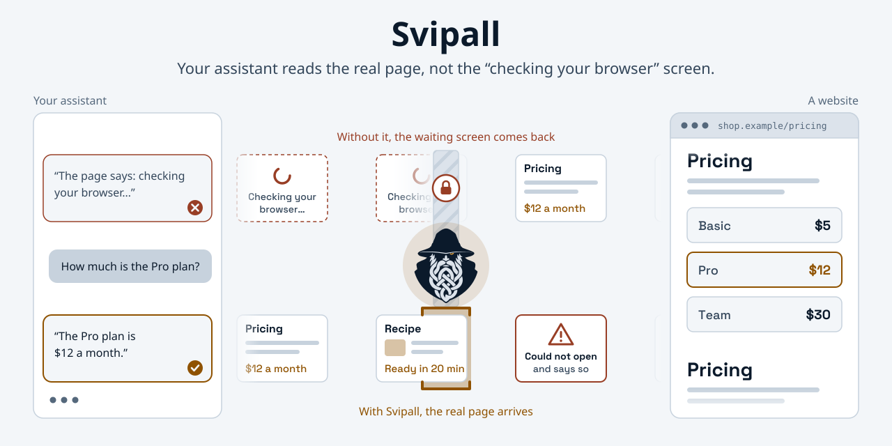

<p align="center">
  <picture>
    <source media="(prefers-color-scheme: dark)" srcset="assets/hero-dark.svg">
    
  </picture>
</p>

<p align="center"><a href="README.md">English</a> · <b>Español</b></p>

<h1 align="center">Jano: un hero SVG animado para tu README de GitHub</h1>

<p align="center"><b>Un skill para agentes que le dibuja a tu repositorio un hero animado en bucle,<br>
para que la primera pantalla del README muestre qué hace el proyecto.</b></p>

<p align="center">Jano lee tu repositorio, decide qué imagen lo explica y la dibuja como un SVG animado en oscuro y en claro. A una herramienta de terminal le pone sus comandos reales, a una aplicación una versión pequeña de su pantalla, a un conversor aquello que convierte. Añade un logotipo si no tienes uno y no toca el texto de tu README. Funciona en Claude Code, en Codex y en cualquier agente que lea el formato Agent Skills.</p>

<p align="center">
  <a href="#instalación"></a>
  <a href="#qué-hace-el-build"></a>
  <a href="https://github.com/ilien-dev/jano/releases"></a>
  <a href="LICENSE"></a>
</p>

<p align="center">
  <a href="#galería"><b>Galería</b></a> ·
  <a href="#instalación"><b>Instalación</b></a> ·
  <a href="#uso"><b>Uso</b></a> ·
  <a href="#qué-obtienes"><b>Qué obtienes</b></a> ·
  <a href="#las-reglas-que-sigue"><b>Reglas</b></a> ·
  <a href="#qué-hace-el-build"><b>Build</b></a> ·
  <a href="#límites"><b>Límites</b></a>
</p>

---

## Galería

Heros hechos con Jano para repositorios reales. Cada uno lo dibujó un agente que solo tenía el repositorio y el skill. Abre un repositorio para ver su hero en su sitio.

**[Svipall](https://github.com/ilien-dev/svipall)**: Tu asistente lee la página real, no la pantalla de «comprobando tu navegador».

<p align="center">
  <picture>
    <source media="(prefers-color-scheme: dark)" srcset="examples/svipall/hero-dark.svg">
    
  </picture>
</p>

**[Muninn](https://github.com/ilien-dev/muninn)**: Tu asistente recuerda tus decisiones y suelta las que cambiaste.

<p align="center">
  <picture>
    <source media="(prefers-color-scheme: dark)" srcset="examples/muninn/hero-dark.svg">
    
  </picture>
</p>

**[Anzu](https://github.com/ilien-dev/anzu)**: Tus libros de Kindle, abiertos en cualquier lector.

<p align="center">
  <picture>
    <source media="(prefers-color-scheme: dark)" srcset="examples/anzu/hero-dark.svg">
    
  </picture>
</p>

**[Quirón](https://github.com/ilien-dev/quiron)**: Hace que el borrador de un chatbot se lea como escrito por una persona, y lo mide.

<p align="center">
  <picture>
    <source media="(prefers-color-scheme: dark)" srcset="examples/quiron/hero-dark.svg">
    
  </picture>
</p>

**[themis](https://github.com/ilien-dev/themis)**: La página de reglas que das a tus asistentes de IA, corta e idéntica en sus dos copias.

<p align="center">
  <picture>
    <source media="(prefers-color-scheme: dark)" srcset="examples/themis/hero-dark.svg">
    
  </picture>
</p>

## Instalación

Con la CLI de [skills](https://skills.sh), que lo instala para Claude Code, Codex, Cursor, Gemini CLI y los demás agentes que soporta:

```sh
npx skills add ilien-dev/jano
```

Como plugin de Claude Code, ejecuta estos dos comandos dentro de Claude Code:

```
/plugin marketplace add ilien-dev/jano
/plugin install jano@jano
```

A mano, copia `skills/jano` a donde tu agente busca los skills: `~/.claude/skills/jano` para Claude Code, `~/.agents/skills/jano` para Codex y otros.

El script de build necesita Python 3.9 o posterior. Con [uv](https://docs.astral.sh/uv/) instala él mismo sus dos dependencias. Sin uv, ejecuta una vez `pip install fonttools brotli`.

## Uso

Jano solo se ejecuta cuando tú lo llamas. El agente nunca lo inicia por su cuenta.

| Agente | Cómo llamarlo |
|---|---|
| Claude Code | `/jano` (como plugin: `/jano:jano`) |
| Codex | `$jano` |
| Otros | «usa el skill jano en este repositorio» |

Abre el agente en el repositorio al que quieres ponerle hero y llama al skill. Puedes añadir lo que quieres ver: `/jano muestra la sincronización entre los dos archivos, conserva nuestro azul`. Escribe los archivos y te enseña una página de vista previa. No hace commit.

## Qué obtienes

```
assets/logo.svg         el logotipo, se conserva si ya tienes uno
assets/hero.src.svg     la fuente que editas tú o el agente
assets/hero-dark.svg    generado desde la fuente
assets/hero-light.svg   generado desde la fuente
README.md               el hero colocado arriba, el resto intacto
```

Jano hace la imagen y nada más. Tu título, tu descripción, tus etiquetas y tus enlaces se quedan como los escribiste.

## Las reglas que sigue

Dos heroes hechos con Jano no deben parecerse, porque la composición sale del proyecto. Lo que comparten son estas reglas.

- **La imagen explica la herramienta.** Quien no lea nada debería adivinar qué hace. Solo entran datos que el repositorio respalda, nunca una cifra inventada.
- **Nunca se detiene ni vuelve a empezar.** Cada animación se repite sin fin y cierra sobre sí misma. No hay entrada ni salida, y tampoco una escena que se arma y se reinicia, así que se ve como un lugar en marcha y no como un video.
- **Algo se mueve en todas partes, una sola cosa manda.** La imagen de la herramienta lleva el movimiento y lo demás se queda discreto.
- **El texto se puede leer.** El título y el eslogan no se mueven. El texto que se desplaza lo hace a velocidad constante y lenta.
- **Tu identidad manda.** Se reutilizan el logotipo y los colores que ya existen. Si no hay, elige un color de acento y deja lo demás neutro.

## Qué hace el build

GitHub muestra un SVG como imagen, así que no cargan scripts ni archivos externos, y un navegador dibuja a saltitos el texto que se mueve despacio. `build.py` resuelve las dos cosas:

- Escribe el archivo oscuro y el claro desde una sola fuente, con una paleta de colores con nombre.
- Incrusta solo las letras usadas de Space Grotesk y JetBrains Mono, para que el hero se vea igual en cualquier equipo.
- Convierte en trazos el texto que se mueve, que así se desliza donde el texto normal iría a tirones.
- Añade la regla que detiene el movimiento a quien pide menos movimiento en su sistema.
- Rechaza animaciones que se reproducen una sola vez, scripts y archivos externos, y avisa de contraste bajo, texto pequeño y archivos pesados.
- Escribe una página de vista previa con los dos temas, al ancho del README y al de un teléfono.

Un hero hecho así pesa entre 50 y 80 KB.

## Límites

- Es una versión temprana. Se ha probado en tres repositorios y la ha usado una sola persona.
- El resultado depende del modelo que lo ejecuta. Un modelo más débil dibuja un hero más débil.
- El agente ve cuadros fijos de su propio trabajo. El movimiento lo revisas tú, en la vista previa.
- Las fuentes son fijas: Space Grotesk y JetBrains Mono. Un proyecto con tipografías propias no las tendrá en el hero.
- El hero está en inglés. El README en español usa el mismo.

## Contribuir

Se aceptan issues y pull requests, un cambio a la vez. Las reglas están en [CONTRIBUTING.md](CONTRIBUTING.md), en inglés. El número de versión lo calcula el workflow de release a partir de los títulos de los pull requests, así que nadie lo escribe a mano.

## Licencia

MIT, ver [LICENSE](LICENSE). Las dos fuentes incluidas están bajo la SIL Open Font License, y sus archivos de licencia están junto a ellas en `skills/jano/assets`.
