<p align="center">
  <picture>
    <source media="(prefers-color-scheme: dark)" srcset="assets/hero-dark.svg">
    
  </picture>
</p>

<p align="center"><b>English</b> · <a href="README.es.md">Español</a></p>

<h1 align="center">Jano: an animated SVG hero for your GitHub README</h1>

<p align="center"><b>Give your repository an animated banner that shows what it does,<br>
in dark and light mode, before anyone reads a word.</b></p>

<p align="center">Jano is an agent skill for Claude Code, Codex and other AI agents. Ask for it once in your project and you get a README header made for that project: its name, a short phrase that says what it is for, and a moving picture of it at work. It comes as an animated SVG banner for GitHub's dark and light themes, already placed at the top of your README.</p>

<p align="center">
  <a href="#install"></a>
  <a href="#what-you-get"></a>
  <a href="https://github.com/ilien-dev/jano/releases"></a>
  <a href="LICENSE"></a>
</p>

<p align="center">
  <a href="#showroom"><b>Showroom</b></a> ·
  <a href="#install"><b>Install</b></a> ·
  <a href="#use"><b>Use</b></a> ·
  <a href="#what-you-get"><b>What you get</b></a> ·
  <a href="#how-it-decides"><b>How it decides</b></a> ·
  <a href="#limits"><b>Limits</b></a>
</p>

---

## Showroom

Real projects, each with the banner Jano drew for it. No two look alike, because no two projects do the same thing. Open a project to see its banner moving.

**[Anzu](https://github.com/ilien-dev/anzu)**: Your Kindle books, as EPUB.

<p align="center">
  <picture>
    <source media="(prefers-color-scheme: dark)" srcset="examples/anzu/hero-dark.svg">
    
  </picture>
</p>

**[Ogmios](https://github.com/ilien-dev/ogmios)**: Practice English speaking with AI.

<p align="center">
  <picture>
    <source media="(prefers-color-scheme: dark)" srcset="examples/ogmios/hero-dark.svg">
    
  </picture>
</p>

**[Quirón](https://github.com/ilien-dev/quiron)**: An AI humanizer that measures its own work.

<p align="center">
  <picture>
    <source media="(prefers-color-scheme: dark)" srcset="examples/quiron/hero-dark.svg">
    
  </picture>
</p>

**[Sharur](https://github.com/ilien-dev/sharur)**: Shorter replies from Claude Code, for less money.

<p align="center">
  <picture>
    <source media="(prefers-color-scheme: dark)" srcset="examples/sharur/hero-dark.svg">
    
  </picture>
</p>

**[Muninn](https://github.com/ilien-dev/muninn)**: A memory that keeps up when you change your mind.

<p align="center">
  <picture>
    <source media="(prefers-color-scheme: dark)" srcset="examples/muninn/hero-dark.svg">
    
  </picture>
</p>

**[themis](https://github.com/ilien-dev/themis)**: Two files, one text.

<p align="center">
  <picture>
    <source media="(prefers-color-scheme: dark)" srcset="examples/themis/hero-dark.svg">
    
  </picture>
</p>

**[Svipall](https://github.com/ilien-dev/svipall)**: The page, or the reason it never arrived.

<p align="center">
  <picture>
    <source media="(prefers-color-scheme: dark)" srcset="examples/svipall/hero-dark.svg">
    
  </picture>
</p>

## Install

One command, for Claude Code, Codex, Cursor, Gemini CLI and the other agents the [skills](https://skills.sh) CLI supports:

```sh
npx skills add ilien-dev/jano
```

Or, inside Claude Code, as a plugin:

```
/plugin marketplace add ilien-dev/jano
/plugin install jano@jano
```

Jano needs Python 3.9 or later on your computer. If you have [uv](https://docs.astral.sh/uv/), that is all; without it, run `pip install fonttools brotli` once.

## Use

Open your agent in the project and call Jano:

| Agent | Call |
|---|---|
| Claude Code | `/jano` (as a plugin: `/jano:jano`) |
| Codex | `$jano` |

and ask for what you want. One hero:

```
/jano make a hero for this repository
```

Four to choose from, each a different picture of the same project:

```
/jano make 4 alternatives for this repository's hero
```

The options open side by side on one page. Keep one, or say what to take from several ("the picture of B with the layout of C"); the README changes only after you choose. In Codex, start with `$jano` instead.

You can say what you want to see: `/jano show a book turning into an EPUB, keep our yellow`. Jano never runs unless you call it, and it does not commit anything.

## What you get

- **An animated banner for the top of your README**, in two versions that follow each visitor's GitHub theme: one for dark mode, one for light.
- **Your README with the banner placed at the top.** Your title, text, badges and links stay as you wrote them.
- **The source of the banner**, so you or the agent can change it later.
- **A preview page** to look at it before you publish.

The files are plain SVG, usually 60 to 130 KB, and they play on GitHub with nothing to install or host.

## How it decides

- **It reads your project first**, then draws what your project actually does: an app as its screen, a terminal tool as its command and what it causes, a converter as the thing it converts.
- **It makes a poster, not a logo animation.** A short text block with the name and what the project is for, beside a picture that moves.
- **It only says what your project can back.** Numbers come from your own benchmarks or not at all; when no number would mean much to your readers, it shows a few plain features instead.
- **It checks its work before saving.** Text large enough to read on a phone, enough contrast in both themes, motion that loops without a jump, and a still picture for people who turn motion off.

It keeps your logo and colors when you have them, and adds no logo when you do not. The full rules are in [`skills/jano/SKILL.md`](skills/jano/SKILL.md).

## Limits

- The result depends on the AI model that runs it: a stronger model draws a better banner.
- The agent sees the motion as stopped frames. You judge how it feels, in the preview.
- Two typefaces are used for every banner, Space Grotesk and JetBrains Mono.
- It has been used on eight projects so far, by one person.

## Contributing

Issues and pull requests are welcome, one change at a time. [CONTRIBUTING.md](CONTRIBUTING.md) has the rules.

## License

MIT, see [LICENSE](LICENSE). The two bundled fonts are under the SIL Open Font License, with their license files in `skills/jano/assets`.
