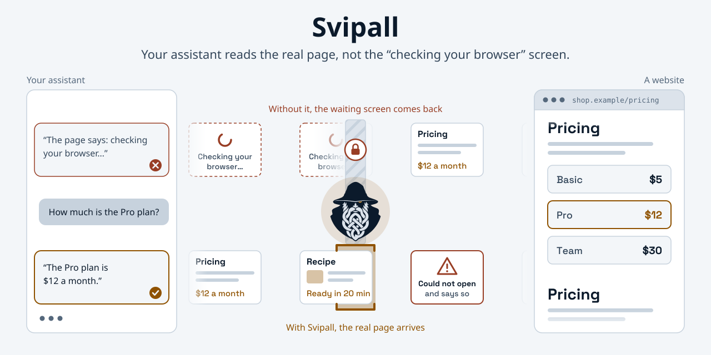

<p align="center">
  <picture>
    <source media="(prefers-color-scheme: dark)" srcset="assets/hero-dark.svg">
    
  </picture>
</p>

<p align="center"><b>English</b> · <a href="README.es.md">Español</a></p>

<h1 align="center">Jano: a README that explains your repository</h1>

<p align="center"><b>Your repo goes in. A README that a stranger understands comes out,<br>
with a moving picture at the top and over each part that needs one.</b></p>

<p align="center">
  <a href="#install"></a>
  <a href="#what-you-get"></a>
  <a href="https://github.com/ilien-dev/jano/releases"></a>
  <a href="LICENSE"></a>
</p>

<p align="center">
  <a href="#how-it-works"><b>How it works</b></a> ·
  <a href="#what-you-get"><b>What you get</b></a> ·
  <a href="#made-with-jano"><b>Made with Jano</b></a> ·
  <a href="#install"><b>Install</b></a> ·
  <a href="#use"><b>Use</b></a> ·
  <a href="#limits"><b>Limits</b></a>
</p>

---

**Jano is a skill for your AI agent that writes and draws your repository's README.** It is for people who own a project and want its front page to explain itself. You call it once, answer a few questions, and it takes your repo along a fixed route: it reads the project, plans each section, writes the text to a size, draws a picture at the top and over the parts that need one, and checks the result before you see it.

## How it works

<p align="center"><picture>
  <source media="(prefers-color-scheme: dark)" srcset="assets/readme/coldread-dark.svg">
  
</picture></p>

The picture above is the last stop on the route. Here is the whole of it:

1. **It reads your project.** The README, the docs and the code, until it can say who it is for and what it does, in one plain sentence.
2. **It asks you, once.** Who reads the README, what to do with anything marked unfinished and, if your project has a screen, whether one section may show a real screenshot. Then it stops asking.
3. **It plans every section.** Each one gets a job, a word budget and, if it helps, a picture.
4. **It draws and writes, then measures.** Scripts check text size, contrast, smooth loops, section length and links, and Jano fixes what they find.
5. **A stranger reads it cold.** Fresh agents that never saw your project look at each picture without its words, and at the whole README. What they get wrong is redrawn or rewritten.

## What you get

<p align="center"><picture>
  <source media="(prefers-color-scheme: dark)" srcset="assets/readme/plan-dark.svg">
  
</picture></p>

- **A README planned section by section.** Kept in `assets/readme/plan.json`, so you can read why each part is there.
- **Text sized to fit.** Each section stays within its word budget; depth that does not fit moves to a page in `docs/`.
- **A moving picture at the top**, the hero, that shows what your project does before a word is read.
- **A picture over each section that needs one**, each showing something of its own.
- **Dark and light versions of every picture.** GitHub shows each visitor the one that matches their theme.
- **Your logo and colours kept**, when you have them.

The pictures are plain SVG files that play on GitHub with nothing to install or host.

## Made with Jano

Heroes Jano drew for other projects: [Anzu](https://github.com/ilien-dev/anzu), [Sharur](https://github.com/ilien-dev/sharur) and [Svipall](https://github.com/ilien-dev/svipall). No two look alike, because no two projects do the same thing.

<p align="center">
<a href="https://github.com/ilien-dev/anzu"><picture><source media="(prefers-color-scheme: dark)" srcset="examples/anzu/hero-dark.svg"></picture></a>
<a href="https://github.com/ilien-dev/sharur"><picture><source media="(prefers-color-scheme: dark)" srcset="examples/sharur/hero-dark.svg"></picture></a>
<a href="https://github.com/ilien-dev/svipall"><picture><source media="(prefers-color-scheme: dark)" srcset="examples/svipall/hero-dark.svg"></picture></a>
</p>

<p align="center"><b><a href="https://jano.ilien.dev/#gallery">See all seven, moving, on jano.ilien.dev</a></b></p>

The name: Jano is Spanish for Janus, the Roman god of doors, drawn with two faces. A README is the door to a repository, and every picture Jano draws has two faces too, one for dark and one for light.

## Install

One command, for Claude Code, Codex, Cursor, Gemini CLI and the other agents the [skills](https://skills.sh) CLI supports:

```sh
npx skills add ilien-dev/jano
```

Or, inside Claude Code, as a plugin:

```text
/plugin marketplace add ilien-dev/jano
/plugin install jano@jano
```

> [!IMPORTANT]
> Jano needs Python 3.9 or later. With [uv](https://docs.astral.sh/uv/) that is all; without it, run `pip install fonttools brotli` once.

## Use

<p align="center"><picture>
  <source media="(prefers-color-scheme: dark)" srcset="assets/readme/ask-dark.svg">
  
</picture></p>

Open your agent in the project and call Jano (`/jano` in Claude Code, `/jano:jano` as a plugin, `$jano` in Codex):

```text
/jano make this repository's README
```

It asks a few questions, each with the answer it would pick and why. After that it works on its own and tells you what it did; it never commits anything.

You can also ask for less:

```text
/jano make a hero for this repository
/jano make 4 alternatives for this repository's hero
```

The first draws only the picture at the top and leaves the rest of your README alone. The second opens four different heroes side by side on one page; you keep one, or say what to take from several.

## Limits

- The result depends on the AI model that runs it: a stronger model draws better pictures.
- The cold read needs an agent that can start other agents. Without one, Jano tells you the check did not run.
- Every picture uses the same two typefaces, Space Grotesk and JetBrains Mono.
- It has been used on a handful of projects so far, by one person.

## Contributing

Issues and pull requests are welcome, one change at a time. [CONTRIBUTING.md](CONTRIBUTING.md) has the rules.

## License

MIT, see [LICENSE](LICENSE). The two bundled fonts are under the SIL Open Font License, and the icon, logo and flag sets Jano draws with (Lucide, Tabler, Phosphor, Fluent, Simple Icons and more) are under MIT, ISC or CC0: every set and its notice are in [THIRD_PARTY_NOTICES.md](THIRD_PARTY_NOTICES.md).
