<p align="center">
  <picture>
    <source media="(prefers-color-scheme: dark)" srcset="assets/hero-dark.svg">
    
  </picture>
</p>

<p align="center"><b>English</b> · <a href="README.es.md">Español</a></p>

<h1 align="center">Jano: a README that explains your project</h1>

<p align="center"><b>Ask once, answer a few questions, and get a front page<br>
with moving pictures, in dark and light, in your own colours.</b></p>

<p align="center">
  <a href="#install"></a>
  <a href="#what-you-get"></a>
  <a href="https://github.com/ilien-dev/jano/releases"></a>
  <a href="LICENSE"></a>
</p>

<p align="center">
  <a href="#what-you-get"><b>What you get</b></a> ·
  <a href="#who-it-is-for"><b>Who it is for</b></a> ·
  <a href="#install"><b>Install</b></a> ·
  <a href="#use"><b>Use</b></a> ·
  <a href="#limits"><b>Limits</b></a> ·
  <a href="#the-name"><b>The name</b></a>
</p>

---

**Jano gives your project a front page that explains itself.** It is a skill for your AI assistant, for anyone who made something and wants a stranger to understand it at a glance. You ask once and answer a few questions. You get back a README that says what your project does, for whom and how to start, with a moving picture at the top and over the parts that need one, in dark and light, in your project's colours.

## What you get

<p align="center"><picture>
  <source media="(prefers-color-scheme: dark)" srcset="assets/readme/features-dark.svg">
  
</picture></p>

- **A moving picture at the top** that shows what your project does before anyone reads a word.
- **A picture over the parts that need one**, each showing something different.
- **Short, plain text**, sized so people read to the end. Longer detail moves to its own page in `docs/`.
- **Dark and light versions of every picture.** GitHub shows each visitor the one that matches their screen.
- **Your logo and colours kept**, when your project has them.

The pictures are ordinary image files that play on GitHub, with nothing to install or host.

## Who it is for

<p align="center"><picture>
  <source media="(prefers-color-scheme: dark)" srcset="assets/readme/audience-dark.svg">
  
</picture></p>

Anyone with a project on GitHub who wants people to get it without reading the code: an app, a tool, a set of files. Jano picks the picture for the kind of project, so no two come out alike. Here are three it drew, [Anzu](https://github.com/ilien-dev/anzu), [Sharur](https://github.com/ilien-dev/sharur) and [Svipall](https://github.com/ilien-dev/svipall), playing as they do on their own pages:

<p align="center">
<a href="https://github.com/ilien-dev/anzu"><picture><source media="(prefers-color-scheme: dark)" srcset="examples/anzu/hero-dark.svg"></picture></a>
<a href="https://github.com/ilien-dev/sharur"><picture><source media="(prefers-color-scheme: dark)" srcset="examples/sharur/hero-dark.svg"></picture></a>
<a href="https://github.com/ilien-dev/svipall"><picture><source media="(prefers-color-scheme: dark)" srcset="examples/svipall/hero-dark.svg"></picture></a>
</p>

<p align="center"><b><a href="https://jano.ilien.dev/#gallery">See all seven front pages, moving</a></b></p>

## Install

One command, for Claude Code, Codex, Cursor, Gemini CLI and the other assistants the [skills](https://skills.sh) tool supports:

```sh
npx skills add ilien-dev/jano
```

Or, inside Claude Code, as a plugin:

```text
/plugin marketplace add ilien-dev/jano
/plugin install jano@jano
```

> [!IMPORTANT]
> Jano needs Python 3.9 or later. With [uv](https://docs.astral.sh/uv/) that is all; without it, run `pip install fonttools brotli` once.

## Use

<p align="center"><picture>
  <source media="(prefers-color-scheme: dark)" srcset="assets/readme/use-dark.svg">
  
</picture></p>

Open your AI assistant in your project's folder and type:

```text
/jano make this repository's README
```

As a Claude Code plugin it is `/jano:jano`, and in Codex `$jano`. Jano asks a few questions, each with the answer it suggests and why: who will read the README, whether to leave out anything that is not finished and, if your project has a screen, whether one part may show a real screenshot. Then it works on its own and tells you what it did. It never commits anything, so you look before you keep it.

You can also ask for less:

```text
/jano make a hero for this repository
/jano make 4 alternatives for this repository's hero
```

The first draws only the picture at the top, which Jano calls the hero, and leaves the rest of your README alone. The second shows four different pictures side by side on one page; you keep one, or say what to take from several.

## Limits

- The result depends on the AI model that runs it: a stronger model draws better pictures.
- Before you see the result, fresh helpers that never saw your project read it cold. That needs an assistant that can start other agents; without one, Jano tells you the check did not run.
- Every picture uses the same two typefaces.
- It has been used on a handful of projects so far, by one person.

## The name

Jano is Spanish for Janus, the Roman god of doors, drawn with two faces. A README is the door to a project, and every picture Jano draws has two faces too, one for dark screens and one for light.

## Contributing

Issues and pull requests are welcome, one change at a time. [CONTRIBUTING.md](CONTRIBUTING.md) has the rules.

## License

MIT, see [LICENSE](LICENSE). The two bundled fonts are under the SIL Open Font License, and the icon, logo and flag sets Jano draws with (Lucide, Tabler, Phosphor, Fluent, Simple Icons and more) are under MIT, ISC or CC0: every set and its notice are in [THIRD_PARTY_NOTICES.md](THIRD_PARTY_NOTICES.md).
